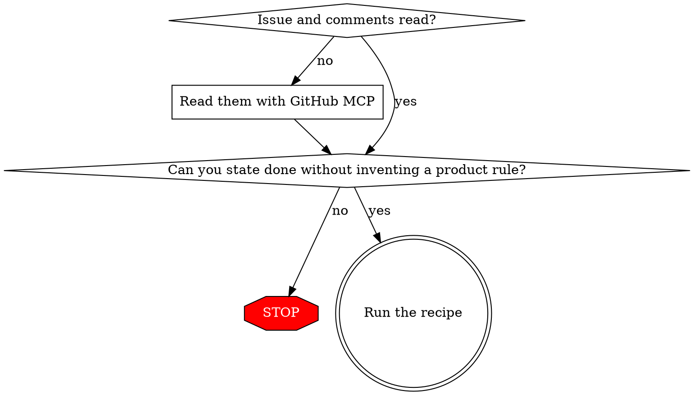

# Autopilot GitHub Execution

## Overview

Implement a GitHub change request without checking in, unless you cannot tell what done means.

**Core principle:** The issue, read in full, is the only spec. If you cannot state done without inventing a product rule, stop. If you can, run the recipe. A subagent approves the spec and plan. You do not.

**Violating the letter of the gates is violating the spirit of the gates.**

## When to Use

- User gives a GitHub issue URL and asks to implement, fix, or deliver it
- User says autopilot, or ready for PR, on a change request
- Issue is empty, contradictory, or missing acceptance criteria
- About to guess, skip a gate, or code it yourself because it looks small

**When NOT to use:** explaining an issue, reviewing an existing PR, or the user said not to implement.

## Understand gate

Read the issue body, labels, and every comment with GitHub MCP before scoping. Title-only is not read. A fetch failure is a failed gate. The user's paraphrase is not the spec.

You understand it only if you can write, from that text, all of:
- requested behavior
- acceptance criteria
- out-of-scope items the issue states

You do not understand it if a user-visible rule is missing, contradicted, or left for someone to make a reasonable call. Design choices the issue leaves open (file layout, internal names) are not this gate.

**You apply this gate. Do not delegate it.** If a subagent would have to decide what the issue is asking, you do not understand it.

### Stop message

The message IS these parts, in order, and nothing else:

1. Blocked. The change request is not understood.
2. Issue URL
3. The contradiction or missing fact
4. The one question that would unblock

No design, no branch, no partial fix, no safe subset.

Example: Product says a credit never changes the tax line. Finance says it must reduce tax proportionally. Stop. Ask which rule is the requirement. Do not pick.

## Recipe

Run every step, including for a one-line change. Documents may be short. Gates may not be skipped.

1. **Isolate.** **REQUIRED SUB-SKILL:** superpowers:using-git-worktrees. Do not implement on the default branch.
2. **Design.** **REQUIRED SUB-SKILL:** superpowers:brainstorming for the design and spec file only. Do not ask the user. Do not offer a visual companion. Do not wait for user approval.
3. **Spec decision and review.** Dispatch a fresh general-purpose subagent on the most capable model (see Model). It decides open design choices and returns only APPROVE or BLOCK. BLOCK for a missing product rule → stop message. BLOCK for a design defect → revise and re-review. No self-approval.
4. **Plan.** **REQUIRED SUB-SKILL:** superpowers:writing-plans. Do not offer an execution choice.
5. **Plan decision and review.** Fresh highest-reasoning subagent. Same APPROVE or BLOCK rule. Then implement. Do not ask which executor to use.
6. **Implement.** **REQUIRED SUB-SKILL:** superpowers:subagent-driven-development. The controller does not write the product code. Implementers use superpowers:test-driven-development.
7. **Review the branch.** **REQUIRED SUB-SKILL:** superpowers:requesting-code-review, highest-reasoning subagent. **REQUIRED SUB-SKILL:** superpowers:verification-before-completion before any ready claim.
8. **Report.** Do not invoke superpowers:finishing-a-development-branch. Do not push, open a PR, or merge.

### Model

Name the model on every subagent dispatch. A dispatch without one inherits the controller's model, so every subagent runs on the most expensive tier.

- **Spec verdict, plan verdict, and final branch review:** the most capable model. Also state in the dispatch prompt that the task needs the deepest reasoning. Always dispatch a general-purpose subagent, never a read-only explore or search agent, for these three. Do not downgrade these three to save time.
- **Every other dispatch** (implementation, fixes, re-reviews, searches, builds, test runs): follow subagent-driven-development's Model Selection. Pick the cheapest model that is reliable for the task.

Record the model that actually ran from the task result. Do not claim a higher model ran.

### Named skip

Skip a gate only when the user's latest message names that gate ("don't commit", "implement it yourself", "skip the plan", "open the PR"). Quote it in the decision log. Skip only that gate.

"Implement it yourself" names only the implement gate. Spec verdict, plan verdict, and branch review still run.

"Don't use subagents" or "no subagents" names every subagent gate: spec verdict, plan verdict, subagent-driven-development, and branch review. Skip those. Do not replace them with self-review and call them done. The understand gate still runs. Do not report ready for PR if branch review was skipped. Report the quote and what is unverified.

Not a named skip: a deadline, "don't stall", "skip the ceremony", "one-liner", "you know the codebase", "don't bother me", a senior's suggestion, a reporter saying "make a reasonable call."

### Follow-up issues

Filing any issue during the run (a plan task, a review finding, an out-of-scope bug): **REQUIRED SUB-SKILL:** filing-follow-up-issues, before the create command.

## Overrides

When this skill applies and the understand gate passes, these do not apply:
- brainstorming's user-approval hard gate and its questions to the user
- writing-plans' execution-choice prompt
- finishing-a-development-branch's option menu

A user instruction that names a gate still wins over this skill.

## Final message

In order:

1. Issue URL and understand-gate PASS
2. Branch and commit range
3. Decisions. Each is question, choice, who decided, model
4. Final branch review verdict and test evidence
5. Ready for PR: yes. PR not opened.

Confirm the change is committed before this message. Present every subagent decision here, not only in a file.

## Quick reference

| Situation | Action |
|---|---|
| Issue unread | GitHub MCP: body, labels, comments |
| Cannot state done | Stop message. End. |
| Understood | Recipe. No user check-in. |
| One-line change | Same recipe. Short docs. |
| Paraphrase conflicts with issue | Stop. Issue wins until the user amends it. |
| Ready for PR | Committed, reviewed, reported. Not pushed. |

## Rationalizations

| Excuse | Reality |
|---|---|
| Ceremony cannot change a one-liner | The recipe still runs. Docs can be short. |
| Don't stall, the meeting is in 15 minutes | Time pressure is not a named skip. |
| I'll implement it myself | The controller does not write the product code. |
| I already self-reviewed the plan | Self-review is not the spec or plan verdict. |
| The user didn't ask for subagents or a commit | This skill is that request. |
| Brainstorming says wait for the user | The subagent approves. See Overrides. |
| The subagent can pick the product rule | Failed understand gate. Stop. |
| Ready for PR means open it | Open or push only if the user named that gate. |
| The user's sentence is enough | Unread comments are an unread issue. |
| I'll note that I skipped SDD | Noting a skip is not permission. Run the step. |
| "Don't use subagents" doesn't name spec review | A subagent ban names every subagent gate. Do not dispatch one anyway. |
| Leave the model unset, the default is fine | Unset inherits the controller's model. Name it: most capable for the three verdicts, cheapest reliable for the rest. |

## Red flags

STOP and return to the gate you skipped:

- Coding the issue yourself
- Spec or plan with no subagent verdict
- Asking the user to approve a settled issue
- Asking a subagent what the requirement is
- A safe subset shipped as the issue
- Push, PR, or merge after ready for PR
- Ceremony, one-liner, don't stall, skip the ceremony
- "No subagents" followed by a spec, plan, or branch-review dispatch
- A subagent dispatch with no model named
- A spec, plan, or branch-review dispatch on less than the most capable model

## Common mistakes

- Treating a reporter's "don't block on me" as acceptance criteria
- Letting the user's paraphrase override unread issue comments
- Invoking finishing-a-development-branch and waiting on a menu
- Recording a skipped gate, then skipping it anyway
